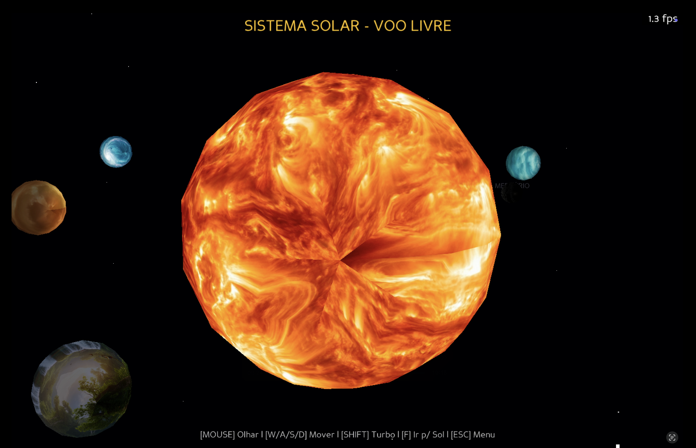
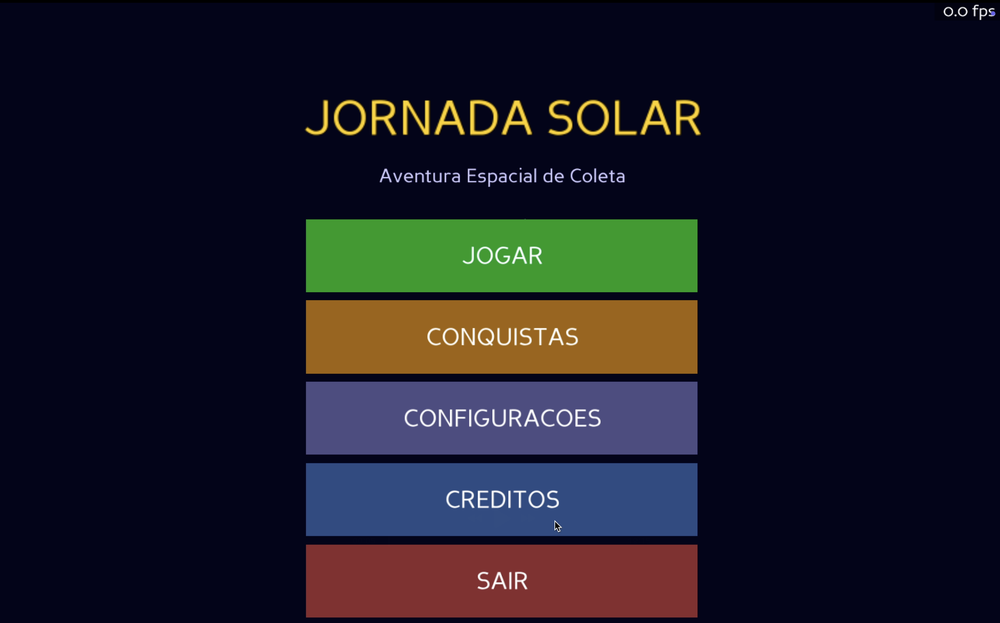
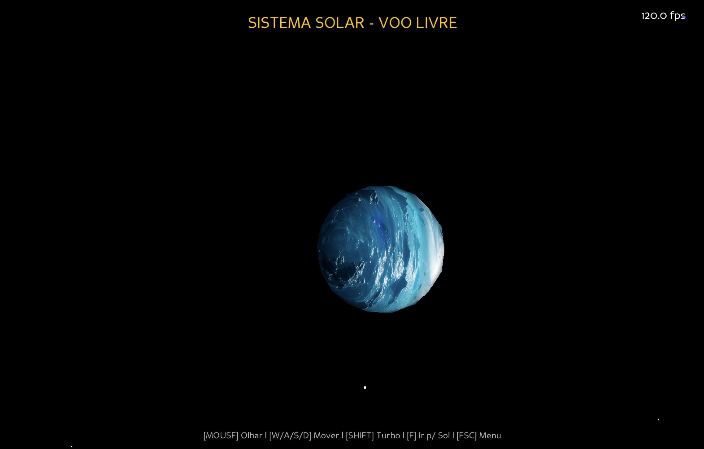
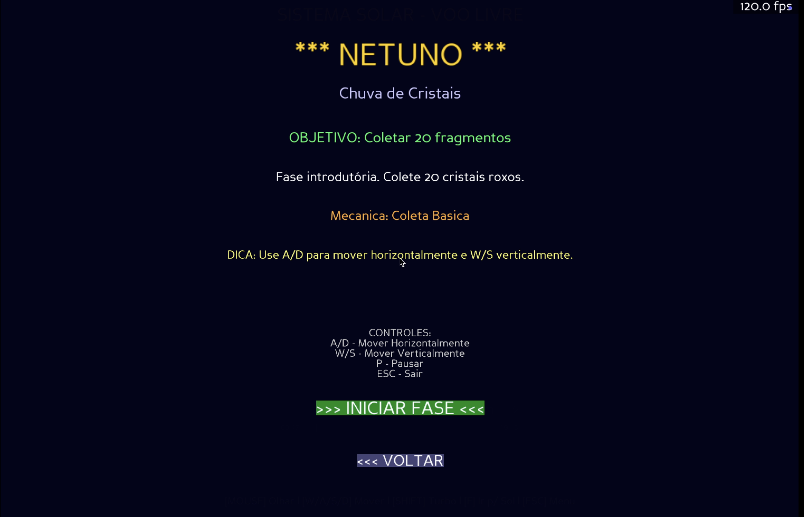
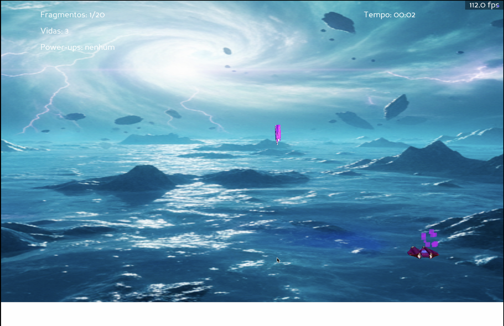
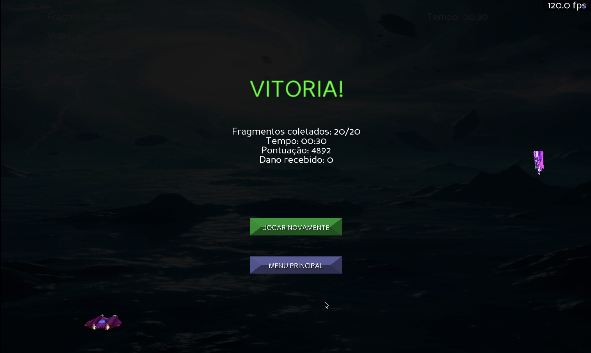

# 🌌 JORNADA SOLAR


**Jornada Solar** é um jogo educacional 3D de aventura espacial desenvolvido em Python com Panda3D. Navegue pelo sistema solar coletando fragmentos de cristal enquanto enfrenta desafios únicos em cada planeta!

---

## Demonstração



O projeto foi desenvolvido por **Eduardo Larson e João Samuel Luy**. Eduardo contribuiu com desenvolvimento e design de sistemas; João Samuel, com desenvolvimento e design de fases. Consulte os créditos para mais detalhes.

## Sobre o Projeto

Este jogo foi desenvolvido como projeto acadêmico para a disciplina de **Computação Gráfica e Processamento Digital de Imagens** e tem como objetivo proporcionar uma experiência divertida e educativa sobre o sistema solar.

### Objetivo do Jogo

Pilote uma nave espacial através de 9 fases representando os planetas do sistema solar (de Netuno até o Sol), coletando fragmentos de cristal enquanto desvia de obstáculos e aprende sobre características únicas de cada corpo celeste.

---

## Características

### Gameplay
- **9 Fases Únicas** - Cada planeta tem mecânicas especiais
- **Sistema de Pontuação** - Baseado em fragmentos coletados, tempo e dano evitado
- **Sistema de Combo** - Colete fragmentos em sequência para bônus
- **3 Power-ups** - Escudo, Imã e Slow-Motion
- **Boss Final** - Enfrente o Sol com mecânica de erupções solares
- **Sistema de Vidas** - Gerencie sua saúde durante as missões

### Sistemas Avançados
- **Sistema de Save** - Progresso automático salvo localmente
- **Recordes por Fase** - Melhores pontuações e tempos salvos
- **Sistema de Conquistas** - 8 achievements desbloqueáveis
- **Efeitos de Partículas** - Explosões, trails e efeitos visuais
- **Sistema de Áudio** - Música contextual e efeitos sonoros
- **Tela Cheia Adaptativa** - Suporte para múltiplas resoluções

### As 9 Fases

| Fase | Planeta | Mecânica Especial | Dificuldade |
|------|---------|-------------------|-------------|
| 1 | **Netuno** | Tutorial - Coleta básica | ⭐ |
| 2 | **Urano** | Ventos laterais alternados | ⭐⭐ |
| 3 | **Saturno** | Chuva de meteoros | ⭐⭐ |
| 4 | **Júpiter** | Raios elétricos horizontais | ⭐⭐⭐ |
| 5 | **Marte** | Fragmentos corrompidos (slow) | ⭐⭐⭐ |
| 6 | **Terra** | Power-ups e lixo espacial | ⭐⭐⭐⭐ |
| 7 | **Vênus** | Chuva ácida | ⭐⭐⭐⭐ |
| 8 | **Mercúrio** | Velocidade extrema | ⭐⭐⭐⭐⭐ |
| 9 | **Sol** | BOSS - Erupções solares | ⭐⭐⭐⭐⭐ |

---

## Instalação

### Requisitos

- **Python 3.11+** (recomendado)
- **Panda3D 1.10.13+**
- **macOS, Linux ou Windows**

### Instalação Rápida

#### 1. Clone o repositório
```bash
git clone https://github.com/edularson/JogoSistemaSolar.git
cd JogoSistemaSolar
```

#### 2. Crie um ambiente virtual (recomendado)
```bash
# macOS/Linux
python3 -m venv venvJSOLAR
source venvJSOLAR/bin/activate

# Windows
python -m venv venvJSOLAR
venvJSOLAR\Scripts\activate
```

#### 3. Instale as dependências
```bash
pip install -r requirements.txt
```

#### 4. Execute o jogo
```bash
python3 main.py
```

### Solução de Problemas (macOS)

Se você encontrar erros de malloc no macOS:
```bash
MallocStackLogging=0 python3 main.py
```

---

## Como Jogar

### Controles

#### No Menu e Lobby
- **Setas ← →** - Navegar entre opções/planetas
- **ENTER** - Selecionar
- **ESC** - Voltar/Sair

#### Durante as Fases
- **A / D** - Mover horizontalmente (esquerda/direita)
- **W / S** - Mover verticalmente (cima/baixo)
- **P** - Pausar jogo
- **ESC** - Sair para o lobby

### Dicas de Gameplay

1. **Colete Fragmentos Roxos** - São seus objetivos principais
2. **Evite Objetos Vermelhos** - Causam dano
3. **Fragmentos Corrompidos** - Vermelhos piscantes deixam você lento
4. **Use Power-ups Estrategicamente**:
   - 🔵 Azul = Escudo (protege de 1 hit)
   - 🟢 Verde = Imã (atrai fragmentos)
   - 🟡 Amarelo = Slow-Motion (desacelera tudo)
5. **Mantenha Combos** - Colete fragmentos em sequência para bônus

---

## Sistema de Pontuação

### Pontos Base
- **+100 pontos** por fragmento coletado
- **+50 pontos** por combo mantido (3+ fragmentos seguidos)
- **+200 pontos** bônus de "sem dano" ao completar fase
- **+10 pontos/segundo** bônus de tempo restante

### Conquistas - (estamos finalizando essa função)

| Ícone | Nome | Descrição |
|-------|------|-----------|
| 🏆 | Primeira Vitória | Complete sua primeira fase |
| 🛡️ | Intocável | Complete uma fase sem tomar dano |
| ⚡ | Demônio da Velocidade | Complete Mercúrio em menos de 2 minutos |
| 💎 | Colecionador | Pegue todos os power-ups em uma fase |
| ⭐ | Mestre Solar | Complete todas as 9 fases |
| 🔥 | Combo Master | Consiga um combo de 10 fragmentos |
| 💯 | Perfeccionista | Colete 100% dos fragmentos |
| ☀️ | Sobrevivente | Derrote o Sol (boss final) |

---

## Arquitetura do Projeto

### Estrutura de Diretórios

```
jornada-solar/
├── core/                      # Sistemas centrais
│   ├── constants.py           # Constantes do jogo
│   ├── resource_loader.py     # Carregamento de assets
│   ├── save_manager.py        # Sistema de save
│   ├── sound_manager.py       # Sistema de áudio
│   ├── ui_manager.py          # Interface de usuário
│   ├── collision_manager.py   # Sistema de colisões
│   ├── particle_manager.py    # Efeitos de partículas
│   └── base_level.py          # Classe base das fases
│
├── entities/                  # Entidades do jogo
│   ├── player.py              # Jogador
│   └── game_entities.py       # Coletáveis, perigos, power-ups
│
├── levels/                    # Fases
│   ├── level_config.py        # Configurações das fases
│   └── specific_levels.py     # Implementação das fases
│
├── screens/                   # Telas do jogo
│   ├── main_menu.py           # Menu principal
│   ├── lobby_3d.py            # Lobby de seleção
│   ├── objectives_screen.py   # Tela de objetivos
│   ├── achievements_screen.py # Tela de conquistas
│   └── settings_screen.py     # Configurações
│
├── models/                    # Modelos 3D (.egg)
├── imgs/                      # Texturas e imagens
├── sounds/                    # Efeitos sonoros (.wav)
├── music/                     # Músicas (.ogg)
│
├── main.py                    # Ponto de entrada
├── requirements.txt           # Dependências
└── README.md                  # Este arquivo
```

### Padrões de Design Utilizados

- **Factory Pattern** - Criação dinâmica de fases
- **Template Method** - BaseLevel com overrides específicos
- **Manager Pattern** - Separação de responsabilidades (Sound, UI, Save, etc)
- **Component Pattern** - Entidades reutilizáveis

---

## Tecnologias

- **[Python 3.11](https://www.python.org/)** - Linguagem de programação
- **[Panda3D 1.10.13](https://www.panda3d.org/)** - Engine de jogos 3D
- **JSON** - Armazenamento de saves e configurações

---

## Progressão de Dificuldade

O jogo foi balanceado para proporcionar uma curva de aprendizado suave:

### Fases 1-3 (Tutoriais)
- Introduz mecânicas básicas
- Ritmo normal de jogo
- Sem power-ups

### Fases 4-6 (Intermediário)
- Mecânicas especiais introduzidas
- Power-ups disponíveis
- Aumenta quantidade de fragmentos

### Fases 7-9 (Avançado)
- Velocidade aumentada progressivamente
- Múltiplas mecânicas simultâneas
- Boss final desafiador

---

## Recursos Visuais

### Efeitos de Partículas
- Explosão ao coletar fragmentos
- Efeito de dano
- Brilho de power-ups
- Trails de movimento

### Interface
- Menu principal animado
- Lobby 3D com planetas rotativos
- HUD informativo durante gameplay
- Telas de vitória/derrota detalhadas
- Sistema de notificações

---

## Configurações

### Ajustes Disponíveis no Jogo
- Volume da música (0-100%)
- Volume dos efeitos sonoros (0-100%)
- Reset de progresso

### Configurações Avançadas (constants.py)

```python
# Velocidade do jogador
PLAYER_HORIZONTAL_SPEED = 0.15

# Velocidade dos fragmentos por fase
SPEED_MULTIPLIER_BY_LEVEL = {
    "terra": 1.0,      # velocidade padrão
    "venus": 1.3,      # 1.3x a velocidade padrão
    "mercurio": 1.3,   # 1.3x mais rápido
    "sol": 1.4         # 1.4x mais rápido
}

# Tamanho dos fragmentos
# Editar em entities/game_entities.py linha 47
self.node.setScale(0.015)  # Padrão
```

---

## Sistema de Save

### Arquivos Gerados

- **save.json** - Progresso do jogo (fases desbloqueadas, completas)
- **highscores.json** - Recordes por fase
- **achievements.json** - Conquistas desbloqueadas
- **config.json** - Configurações de volume e preferências

### Localização
```
jornada-solar/
├── save.json
├── highscores.json
├── achievements.json
└── config.json
```

### Backup Manual
```bash
# Fazer backup dos saves
cp save.json save_backup.json
cp highscores.json highscores_backup.json

# Restaurar backup
cp save_backup.json save.json
```

---

## Créditos

### Desenvolvimento
- **Eduardo Larson** - Desenvolvimento, Design de Sistemas
- **João Samuel Luy** - Desenvolvimento, Design de Fases

### Projeto Acadêmico
- **Disciplina:** Computação Gráfica e Processamento Digital de Imagens
- **Professor:** Jotair Elio Kwiatkowski Junior
- **Instituição:** Universidade Estadual do Centro-Oeste - UNICENTRO
- **Ano:** 2026

### Tecnologias
- Engine: Panda3D (Carnegie Mellon University)
- Linguagem: Python Software Foundation

---

## Licença

Este projeto foi desenvolvido para fins educacionais como parte do curso de Ciência da Computação.

```
MIT License

Copyright (c) 2026 Eduardo Larson & João Samuel Luy

Permission is hereby granted, free of charge, to any person obtaining a copy
of this software and associated documentation files (the "Software"), to deal
in the Software without restriction, including without limitation the rights
to use, copy, modify, merge, publish, distribute, sublicense, and/or sell
copies of the Software, and to permit persons to whom the Software is
furnished to do so, subject to the following conditions:

The above copyright notice and this permission notice shall be included in all
copies or substantial portions of the Software.

THE SOFTWARE IS PROVIDED "AS IS", WITHOUT WARRANTY OF ANY KIND, EXPRESS OR
IMPLIED, INCLUDING BUT NOT LIMITED TO THE WARRANTIES OF MERCHANTABILITY,
FITNESS FOR A PARTICULAR PURPOSE AND NONINFRINGEMENT.
```

---

## Contribuindo

Este é um projeto acadêmico, mas sugestões são bem-vindas!

1. Faça um Fork do projeto
2. Crie uma branch para sua feature (`git checkout -b feature/MinhaFeature`)
3. Commit suas mudanças (`git commit -m 'Adiciona MinhaFeature'`)
4. Push para a branch (`git push origin feature/MinhaFeature`)
5. Abra um Pull Request

---

## Suporte

### Problemas Comuns

**Jogo não abre / Tela preta**
- Verifique se Panda3D está instalado: `pip show panda3d`
- Certifique-se de estar no diretório correto

**Fragmentos invisíveis / Texturas faltando**
- Copie as pastas `models/` e `imgs/` do projeto completo
- O jogo funciona sem texturas (usa cores sólidas como fallback)

**Sem som**
- Normal se não houver arquivos em `sounds/` e `music/`
- O jogo funciona perfeitamente sem áudio

**Erro de emoji no macOS**
- Os emojis foram removidos da versão final
- Atualize para a última versão dos arquivos de tela

### Contato

- Email: [eduardolarson05@gmail.com]
- Issues: [GitHub Issues](https://github.com/edularson/JogoSistemaSolar/issues)

---

## Agradecimentos

Agradecimentos especiais a:
- Professor Jotair pela orientação
- Colegas de classe pelos testes e feedback

---

## Screenshots








---

## Próximas Melhorias (Futuro)

- [ ] Modo multiplayer local
- [ ] Mais power-ups
- [ ] Sistema de conquistas online
- [ ] Editor de fases
- [ ] Suporte a controles/joysticks
- [ ] Modo história expandido
- [ ] Tradução para outros idiomas

---

<div align="center">

**Desenvolvido com ❤️ e ☕ por Eduardo Larson & João Samuel Luy**

⭐ Se você gostou do projeto, deixe uma estrela!

[⬆ Voltar ao topo](#-jornada-solar)

</div>